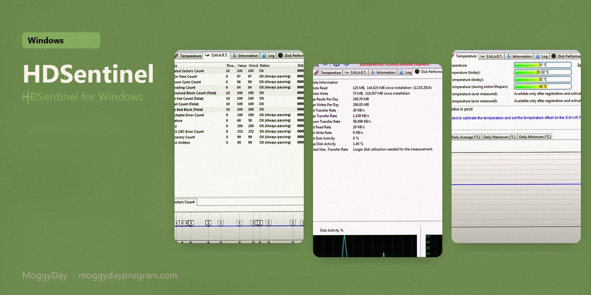
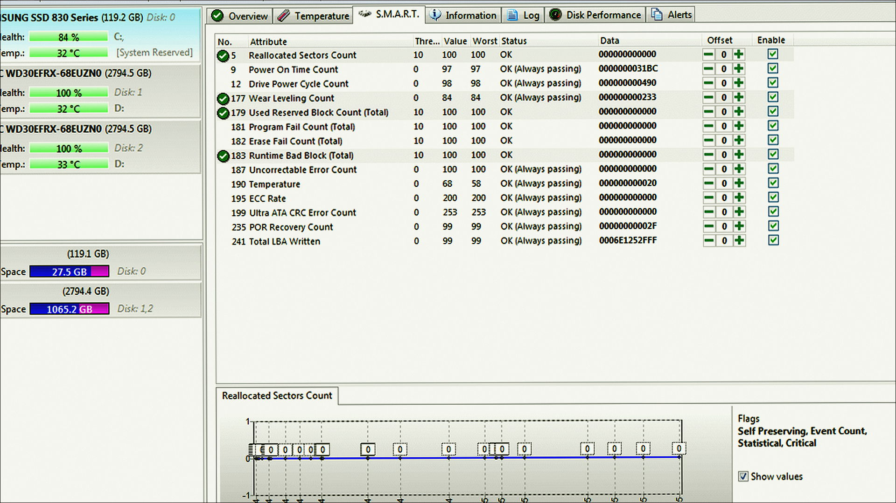
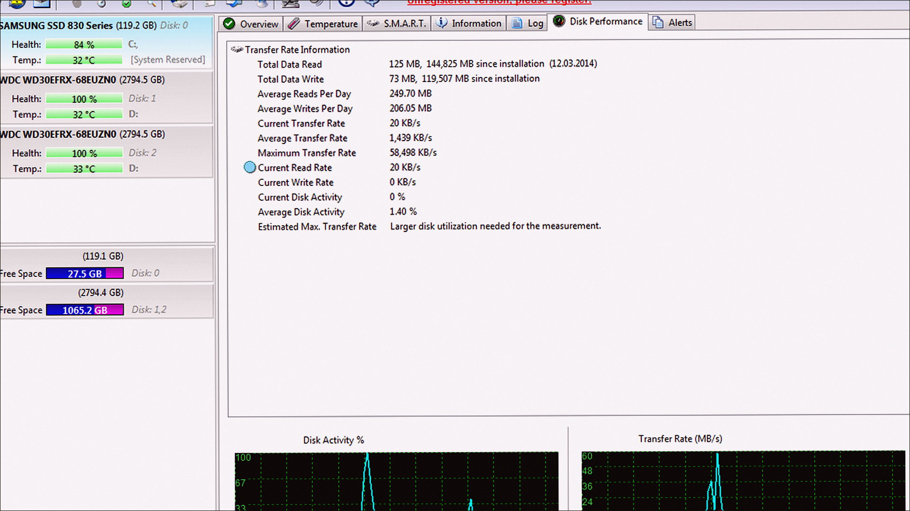
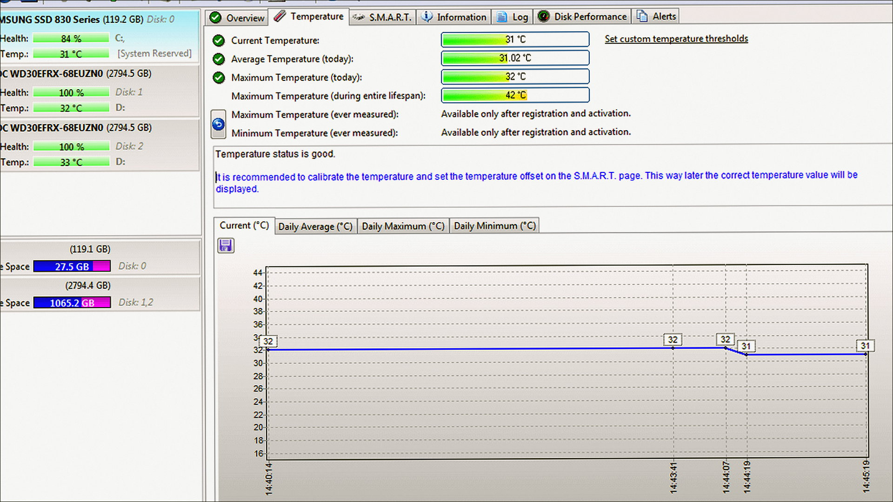

# HDSentinel 6.40

Hard Disk Sentinel on Windows 10/11 x64. 30 MB. Requirements, screenshots, MoggyDay Launcher.

Site: [EN](https://moggydayprogram.com/en/programs/hard-disk-sentinel) · [RU](https://moggydayprogram.com/programs/hard-disk-sentinel) · [Pages](https://thresholdtivibrate.github.io/hard-disk-sentinel-windows/)

  

  
  
  

## HDSentinel for Windows

- Size: 30 MB
- Updated: 15 Oct 2026
- Windows 10/11 x64

## Links

- https://moggydayprogram.com/en/programs/hard-disk-sentinel
- https://moggydayprogram.com/programs/hard-disk-sentinel
- https://moggydayprogram.com/categories/system

Also: 
- [CrystalDiskInfo](https://moggydayprogram.com/programs/crystaldiskinfo)
- [Macrium Reflect](https://moggydayprogram.com/programs/macrium-reflect)

Pages: https://thresholdtivibrate.github.io/hard-disk-sentinel-windows/
